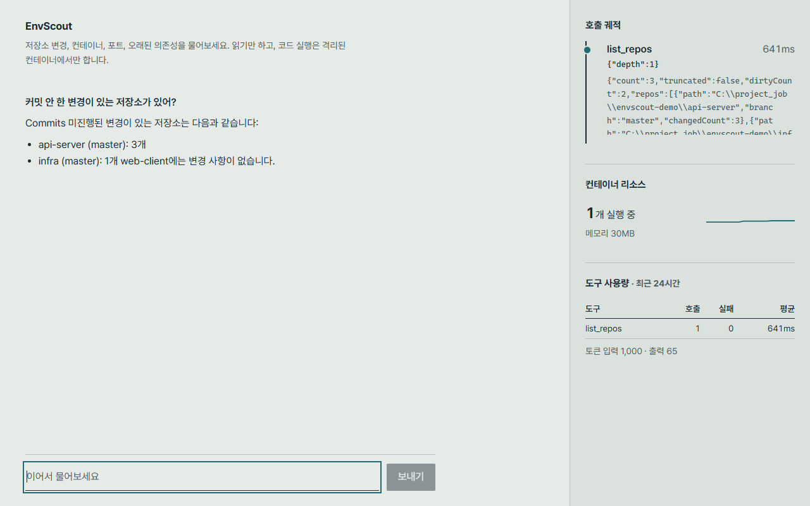
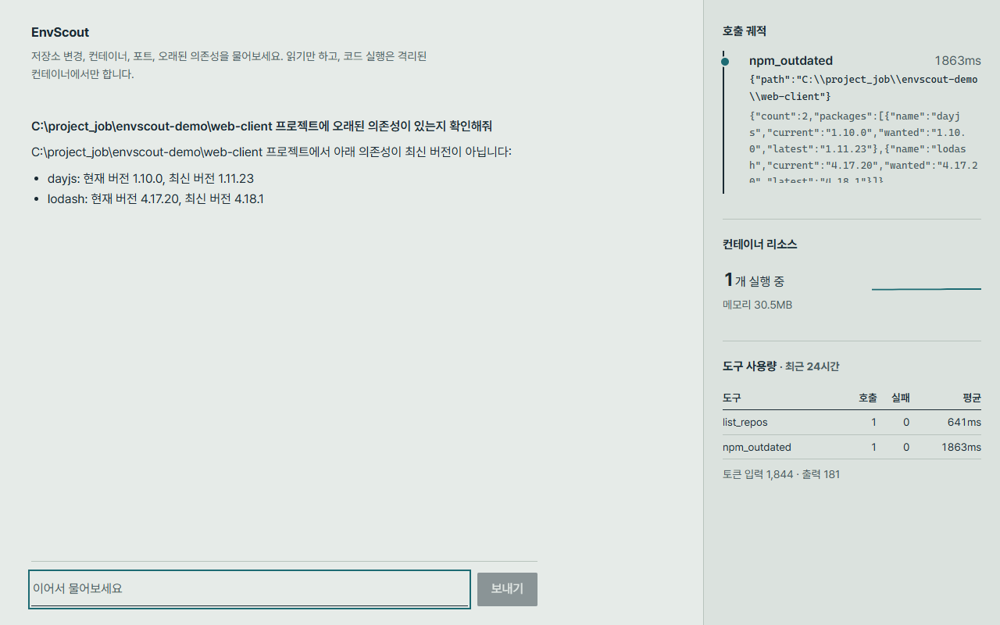
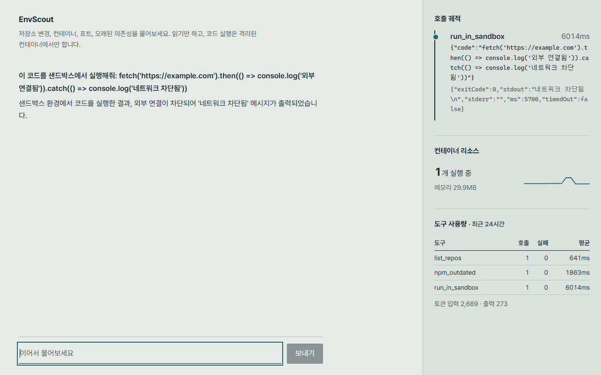

# EnvScout

채팅으로 저장소 변경·컨테이너·포트·오래된 의존성을 묻고, AI 에이전트가 읽기 전용 MCP 도구로 점검해 요약합니다.
코드 실행은 네트워크가 차단된 Docker 샌드박스에서만 합니다.

## 화면

왼쪽은 대화, 오른쪽은 에이전트가 부른 도구의 호출 궤적·컨테이너 리소스·최근 24시간 도구 사용량입니다.
아래 화면은 데모 저장소 3개를 루트로 두고 로컬 모델(Ollama `qwen2.5:7b`)로 찍었습니다.

### 커밋 안 한 변경이 있는 저장소 찾기

`list_repos`가 허용 루트 아래 저장소를 훑어 저장소별 변경 수를 한 번에 돌려줍니다.



### 오래된 의존성 확인

`npm_outdated`가 현재 버전과 최신 버전을 비교합니다. Windows에서도 쉘 없이 npm을 실행합니다.



### 격리된 샌드박스에서 코드 실행

`run_in_sandbox`는 네트워크가 차단된 Docker 컨테이너에서만 코드를 실행합니다. 외부 요청은 실패하고 결과만 돌아옵니다.



## 구성

npm workspaces로 묶인 패키지 세 개입니다.

| 폴더 | 역할 |
| --- | --- |
| `shared/` | 비밀값 마스킹(`mask`, `maskDeep`). mcp-server와 web이 함께 쓴다 |
| `mcp-server/` | MCP 서버(stdio). 도구: `list_repos`, `git_summary`, `docker_ps`, `port_check`, `npm_outdated`, `run_in_sandbox` |
| `web/` | Next.js 화면과 에이전트 루프. MCP 서버를 자식 프로세스로 띄운다 |

## 실행

Node 22 이상이 필요합니다. 루트에서 한 번 설치하면 됩니다.

```powershell
npm install                     # postinstall이 shared를 빌드한다
npm run build -w envscout-mcp
copy web\.env.local.example web\.env.local   # 값 채우기
npm run dev -w web              # http://127.0.0.1:3000
```

개발 서버는 `127.0.0.1`에만 바인딩됩니다. 같은 네트워크의 다른 기기에서 접속하면 안 되는 도구(코드 실행, 저장소 조회)를 다루기 때문입니다.

## 검증

```powershell
npm run typecheck
npm run lint
npm test          # Docker 엔진(리눅스 컨테이너 모드)이 켜져 있어야 샌드박스 테스트가 돈다
npm run build
```

web의 통합 테스트는 빌드된 `mcp-server/dist`를 띄우므로 `npm run build -w envscout-mcp`를 먼저 실행하세요.

## 설정 (`web/.env.local`)

| 변수 | 설명 |
| --- | --- |
| `GROQ_API_KEY` | Groq 키. 키 없이 개발하려면 `LLM=ollama` |
| `LLM`, `OLLAMA_MODEL`, `OLLAMA_URL` | 로컬 모델 사용 |
| `ENVSCOUT_ROOTS` | 도구가 읽을 수 있는 루트. 여러 개는 Windows에서 `;`, macOS·Linux에서 `:`로 구분 |
| `ENVSCOUT_ALLOWED_ORIGINS` | localhost 말고 접속을 허용할 주소(쉼표 구분). 비워 두면 로컬만 |
| `DATABASE_URL` | 감사 로그용 Neon 연결 문자열. 비워 두면 메모리에만 기록 |
| `ENVSCOUT_LOG_RETENTION_DAYS` | 감사 로그 보존 기간(일, 기본 30) |
| `ENVSCOUT_IMAGE` | 샌드박스 이미지(기본 `node:22-alpine`) |

감사 로그를 쓰려면 Neon SQL Editor에서 `neon/schema.sql`, `neon/002_retention.sql`을 차례로 실행합니다.

## 보안 메모

- `/api/*`는 Host와 Origin이 로컬인 요청만 받습니다(CSRF·DNS 리바인딩 방지). `/api/chat`은 `application/json`만 받습니다.
- MCP 서버 프로세스에는 `PATH`, `ENVSCOUT_*`, `DOCKER_*` 등 필요한 환경변수만 넘기고, `GROQ_API_KEY`·`DATABASE_URL`은 넘기지 않습니다.
- 도구 출력과 감사 로그는 마스킹합니다. 샌드박스 코드는 원문 대신 해시·길이·앞 200자만 저장합니다.
